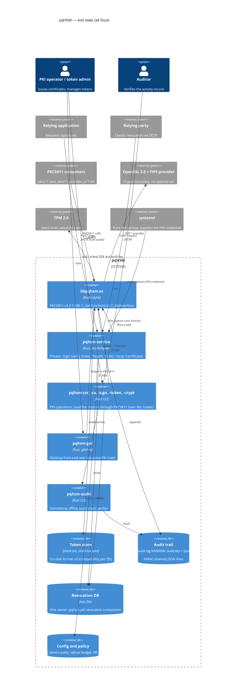
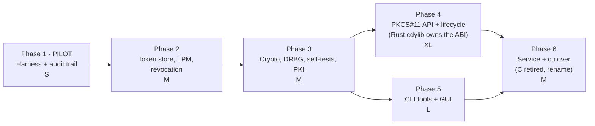

# Modernization Brief — pqHSM (FreeHSM 2.6.0, C11 → Rust)

*Generated 2026-10-30 by `/code-modernization:modernize-brief pqHSM rust`. This is the first brief
for this system; no earlier `MODERNIZATION_BRIEF.md` existed.*

**Built from** (modification times, 2026-10-30 local time):

| Input | Modified | Produced by |
|---|---|---|
| `PREFLIGHT.md` | 00:28 | `/modernize-preflight` (Check 0 answers are the human's, verbatim) |
| `ARCHITECTURE.mmd` | 00:34 | `/modernize-assess` |
| `ASSESSMENT.md` | 00:40 | `/modernize-assess` |
| `topology.json`, `call-graph.mmd`, `data-lineage.mmd`, `critical-path.mmd` | 01:05 | `/modernize-map` |
| `BUSINESS_RULES.md`, `DATA_OBJECTS.md` | 01:19 | `/modernize-extract-rules` |

`DELTA_CATALOG.md` does not apply: this is a cross-stack rewrite, not a same-stack uplift.

> **How to steer this plan.** `/modernize-transform` reads this file and treats each phase's
> **Scope**, **Entry criteria** and **Exit criteria** as binding gates. To change what happens,
> **edit this file**: an edited criterion is honoured; a note in chat is not.

---

## 1. Objective

pqHSM (renamed from FreeHSM) is a software HSM. It is one PKCS#11 v3.2 shared library, plus:
- an HTTP signing and OCSP service;
- five PKI command-line tools;
- a GTK desktop app.

It is 30k lines of C11 on the OpenSSL 3.5 FIPS provider, with 92 mechanisms including the NIST
post-quantum algorithms. The goal is to rewrite **the complete system** in Rust (the human's
scope answer) behind the **unchanged PKCS#11 C ABI**. That ABI is the only contract the
external binary consumers see: OpenSC `pkcs11-tool`, OpenSSL `pkcs11-provider` and p11-kit.

**Why now:**
- **The C core has concentrated, memory-unsafe risk.** One 13,400-line file holds 37% of all complexity and every API entry point.
- **Discovery found two High-severity defects and a set of reproduced lifecycle defects.** Logged-out key use and offline key injection are the High ones. The lifecycle defects: PIN change impossible, no "not initialized" gate, self-tests skippable.
- **A rewrite is the cheapest point to fix them.** Each defect becomes a **recorded, intended divergence**, not something re-ported.
- **The behaviour oracle is unusually strong and executable.** 110+ passing tests, CAVP/KAT/Wycheproof vectors and a 92-mechanism probe all drive the library through the ABI, so the C and Rust builds can be run side by side and diffed.

## 2. Target Architecture



**The Cargo workspace is `modernized/pqHSM/`**, in place of the C tree. It is one crate per
legacy domain.

**During the transition there is no new external interface.** Phases 1–3 build crates as a Rust
`staticlib` that exports the *same internal C symbols* (`fhsm_audit_*`, `fhsm_token_*`, …) and
is linked into `libfreehsm.so` in place of the C files it replaces. The tests that link internal
symbols therefore keep running unchanged. In Phase 4 the Rust `cdylib` takes over
`C_GetFunctionList`.

| Legacy component | Today | Target component(s) | Phase |
|---|---|---|---|
| D7 Audit trail + verifier | `src/fhsm_audit.c`, `tools/freehsm_audit.c` | `pqhsm-audit` crate (library), plus the `pqhsm-audit` verifier binary | 1 |
| D3 Token store + TPM sealing | `src/fhsm_token.c`, `fhsm_token_tpm.c`, `fhsm_tpm.c` | `pqhsm-token` crate. TPM via `std::process::Command` with an absolute path, not `system()` (SEC-006) | 2 |
| D8b Revocation DB | `src/fhsm_revocation.c` (written by 2 tools, read by the service) | revocation component of `pqhsm-pki`, the single owner of the file | 2 |
| D4 Crypto core, DRBG, secure heap, conf | `src/fhsm_crypto.c`, `fhsm_drbg.c`, `fhsm_memory.c`, `fhsm_conf.c` | `pqhsm-crypto` (`openssl-sys` to the same FIPS provider; `zeroize` with mlocked secure-heap allocations) | 3 |
| D6 Self-tests and integrity | `kat/fhsm_kat_vectors.c`, `kat/cavp_extended.c`, `src/fhsm_integrity.c`, `fhsm_pairwise.c` | `pqhsm-selftest` | 3 |
| D8a Composite ML-DSA and PKI encoders | `src/fhsm_composite.c`, `include/fhsm_pki.h` | `pqhsm-pki` (X.509, CSR, CRL, OCSP, CMS, composite) | 3 |
| D1 PKCS#11 API and object model | `src/fhsm_pkcs11.c` (13.4k lines), `fhsm_create_attrs.c`, `fhsm_pq_params.c`, `fhsm_ecdsa_raw.c` | `pqhsm-core` (object model, policy, per-session operation state) plus `pqhsm-p11` cdylib (ABI shim, function list) | 4 |
| D2 Lifecycle, sessions, API lock | `src/fhsm_state.c`, `fhsm_session.c`, `fhsm_apilock.c` | `pqhsm-core::{state, session, lock}` | 4 |
| D5 Mechanism registry and dispatch | `src/gen/fhsm_dispatch.c` (advertisement only), `src/dispatch/*` and `src/fhsm_mode.c` (dead or inert) | the advertised mechanism table only, folded into `pqhsm-core`. **The dead dispatch handlers and runtime mode are not ported** (Q16) | 4 |
| D10 CLI tools and GUI | `tools/fhsm_{csr,ca,sign,token,crypt}.c`, `pkiops.c`, `cms_env.c`, `fhsm_gui.c` | `pqhsm-cli` binaries and `pqhsm-gui` (gtk4-rs); both load the module through their own `libc` loader (was `cryptoki`, changed 2026-11-09) | 5 |
| D9 HTTP signing and OCSP service | `service/fhsm_service.c` (statically links all module objects) | `pqhsm-service` (axum/hyper). Links `pqhsm-core` as a crate, which replaces the non-exported `fhsm_audit_set_actor` workaround | 6 |
| D11 Build, CI and release | `Makefile`, `scripts/*`, `.github/workflows/*`, `Dockerfile.build` | Cargo workspace; CI jobs moved over: sanitizers become Miri + ASan on FFI tests, fuzz becomes cargo-fuzz, reproducible-build and Wycheproof jobs kept. The C build stays as the oracle until Phase 6 | 1 (harness) to 6 (switch) |
| Docs and evidence | `docs/` (FIPS 140-3 and CC-style evidence; not certified, none planned) | rewritten against the Rust module; brand assets dropped (Q19) | 6 |

## 3. Phased Sequence

**Pattern:** strangler fig behind the C ABI, leaf domains first. Execution command for every
phase: **`/modernize-transform`**.



Phases 4 and 5 are independent and can run in parallel. The tools reach the module only through
the PKCS#11 ABI, so they can be validated against the C library, the hybrid library or the Rust
library.

**Relative scale** comes from the assessment's COCOMO-II index (`2.94 × KSLOC^1.10`; shipping code
index 124.7, measured with `scc` on each phase's files).

| Phase | Shipping KSLOC | Index | Share of code / of complexity | T-shirt |
|---|---:|---:|---|---|
| 1 | 1.18 | 3.5 | 4% / ~0% (scc's complexity count for the audit code is very low; read the size as the signal) | **S** |
| 2 | 2.76 | 9.0 | 9% / 8% | **M** |
| 3 | 5.19 | 18.0 | 17% / 18% | **M** |
| 4 | 9.77 | 36.1 | 32% / 40% | **XL** |
| 5 | 6.92 | 24.7 | 23% / 21% | **L** |
| 6 | 1.77 + cutover | 5.5 | 6% / 7% | **M** |

About 2.6 KSLOC (the dead dispatch layer, `fhsm_mode.c` and `kat/fhsm_kat_rsp.c`) is not ported.
**The index ranks phases against each other. It is not a duration or a cost, and none is implied.**

> **Phase 1 is a pilot, and this brief is a hypothesis.** Phase 1 takes one leaf domain (the audit
> trail) all the way through the recipe every later phase reuses. It validates:
> - the Rust `staticlib` behind the existing internal C symbols;
> - the link swap in the Makefile;
> - the dual-execution harness;
> - CI;
> - the playbook.
>
> Expect what it surfaces to **revise this brief**: a linker or allocator interaction, a fork or
> thread surprise, an environment fact nobody wrote down. A regenerated brief after the pilot is
> the normal path, not a correction. Legacy systems hide their surprises in the build and the
> runtime, not in the source. Phases 4 and 5 also each start with their own named pilot slice.

### Phase 1 — Pilot: dual-execution harness and audit trail (D7)

- **Scope:** create the `modernized/pqHSM/` Cargo workspace and the hybrid build. `make -f modernized/pqHSM/hybrid.mk` (an out-of-tree wrapper that includes the unchanged legacy `Makefile`, per Q4) links the Rust `staticlib` into `libfreehsm.so` in place of `src/fhsm_audit.c`, with `-Wl,--exclude-libs,ALL` so the exported symbol set is unchanged; plain `make` still builds the pure-C oracle. A ~20-line C adapter keeps the variadic `fhsm_audit_event` signature until Phase 4. Builds run in a derived image (`modernized/pqHSM/Containerfile.rust`, `FROM localhost/freehsm-build:1.2.0`, Rust 1.99.1). The harness uses the existing test binaries and the 92-mechanism probe as the recorded call sequences *(decided 2026-10-30)*.
  - Build the **dual-execution harness.** It replays recorded PKCS#11 call sequences (the test suite plus the 92-mechanism probe) against both libraries and diffs return codes, outputs and on-disk side effects. Randomised outputs are checked by cross-verification, not byte comparison.
  - Port `src/fhsm_audit.c` to the `pqhsm-audit` crate, and `tools/freehsm_audit.c` to the `pqhsm-audit` verifier.
  - Until Phases 2 and 3, the audit crate calls the existing C secure heap and TPM functions over FFI.
- **Entry criteria:**
  - [x] §8 is signed, and covers at least Phase 1. *(2026-10-30, Phase 1 only)*
  - [x] Q1–Q4 in §7 are ticked. *(2026-10-30)*
  - [x] `analysis/pqHSM/BASELINE.md` exists. *(2026-10-30: 106/106 pass; FIPS-provider baseline deferred to Phase 3)* It records the pure-C build in the pinned image (`localhost/freehsm-build:1.2.0`): the `make tests` result per test, KAT/CAVP/Wycheproof pass counts, the 92-mechanism probe output, and sample audit logs. It also records a **FIPS-provider baseline** (the gap preflight left open) or marks that baseline as explicitly deferred to Phase 3.
  - [x] *(2026-10-30: cargo-audit 0.22.2, cargo-deny 0.20.2, cargo-fuzz 0.13.2, nightly installed)* `cargo-audit`, `cargo-deny` and `cargo-fuzz` (with the nightly toolchain) are installed (preflight Check 3c gap).
  - [x] *(2026-10-30: DIV-001 to DIV-005 decided)* `analysis/pqHSM/DIVERGENCES.md` exists and records a preserve-or-fix decision for every suspected-defect rule gated at Phase 1 in §5.
- **Exit criteria:**
  - [x] *(2026-10-30: 106/106; `nm -D` and NEEDED identical)* The hybrid `libfreehsm.so` passes the full `make tests`, including tests that link internal symbols (`$(LIB_OBJ)`), with the same per-test results as `BASELINE.md`.
  - [x] *(2026-10-30: 64/68 identical; 4 explained in PILOT_PLAYBOOK.md §4.10)* The harness shows **zero unexplained diffs** in audit records across the test corpus, after normalising `ts` and the MACs that depend on it. Every remaining diff is listed in `DIVERGENCES.md`.
  - [x] *(2026-10-30)* Cross-verification holds both ways: the C verifier accepts logs the Rust build wrote, and the Rust verifier accepts logs the C build wrote. Property tests (proptest) show that any single-byte edit, deletion or reorder is rejected.
  - [x] *(2026-10-30: DIV-006 to DIV-009 decided)* Every P0 rule gated at Phase 1 in §5 passes.
  - [x] *(2026-10-30: `audit/src/ffi/`)* `unsafe` appears only in the FFI shim module. `cargo clippy -D warnings` and `cargo deny check` are clean.
  - [x] *(2026-10-30, approved)* `analysis/pqHSM/PILOT_PLAYBOOK.md` is written: the recipe, the link-swap steps, harness usage, and every surprise met.
  - [x] *(2026-10-30: re-approved with two edits: `catch_unwind` dropped from risk 1, and the two Phase 2 entry criteria from playbook §5 added)* **This brief is regenerated, or re-approved unchanged, against the playbook.**
- **Risk: Medium.**
  1. *Mixed Rust/C link: allocators, `panic` across FFI, symbol clashes.* Mitigation: `panic = "abort"` (a panic aborts before it can unwind across FFI, so `catch_unwind` would be dead code); check exported symbols with `nm` against `include/fhsm_audit.h`; check signature compatibility with bindgen-generated declarations.
  2. *Fork and thread semantics of the audit file descriptor and mutex (RULE-077).* Mitigation: replicate the `pthread_atfork` handlers; run the existing fork and concurrency tests on the hybrid build under TSan.

### Phase 2 — Persistence and key custody: token store, TPM sealing, revocation DB (D3, D8b)

- **Scope:** `src/fhsm_token.c`, `fhsm_token_tpm.c`, `fhsm_tpm.c` → `pqhsm-token`, and `src/fhsm_revocation.c` → the revocation component of `pqhsm-pki`. On-disk formats as `DATA_OBJECTS.md` records them.
- **Entry criteria:**
  - [x] *(2026-10-30)* Phase 1 exit criteria are met, and `PILOT_PLAYBOOK.md` is approved.
  - [x] *(2026-10-30)* Q5–Q8 are ticked.
  - [x] *(2026-10-30 day-1 run: 106/106; corpus 64 same, 4 DIFF, the same four commands explained in playbook §4.10; TSan 4/4 rc=0, 0 races)* The harness runs the corpus diff (with its C-against-C control) and TSan from the start of the phase, not only at the end (playbook §5).
  - [x] *(2026-10-30: 6 HIGH, 5 MEDIUM, 4 LOW, all applied in `PHASE2_PLAN.md` §7; plan approved, user: "Approve plan + amendments")* The architecture-critic review of the planned crate and its divergences is done **before** the characterization tests are approved, and its HIGH findings are decided (playbook §5).
  - [x] *(2026-10-30: DIV-010 to DIV-016 and the deferral table decided)* `DIVERGENCES.md` has a decision for every suspected-defect rule gated at Phase 2.
  - [x] *(2026-10-30: 7 tokens, 1 `.tpm` written through the stub seam, 6 revocation DBs, and C's read-back in `manifest.tsv` and `revocation.tsv`; regenerated by `tests-support/golden/regen_token.sh`)* A golden corpus of C-written files is committed under `modernized/pqHSM/testdata/`:
    - token files covering fresh, user-initialised, locked and multi-object tokens, plus a ≤2.5.0 zero-DEK token if Q6 keeps a migration path;
    - `.tpm` companion files;
    - revocation DBs.
- **Exit criteria:**
  - [x] *(2026-11-01: 106/106; `nm -D` and NEEDED identical; C token, TPM and revocation objects empty)* The hybrid build passes `make tests` against the baseline.
  - [x] *(2026-11-01: Rust reproduces `testdata/manifest.tsv` and `revocation.tsv`; C's `gen_token describe` of the Rust-written corpus equals `manifest.tsv`, serials masked; the 66 token files the tests leave load in both readers. Recorded exception: `zero_dek_2_5_0.tok` no longer logs in under Rust, DIV-010/Q6)* File compatibility is round-trip clean: Rust loads every C-written file, and C loads every Rust-written file, unless a recorded Q5 decision says otherwise.
  - [x] *(2026-11-01: audit records 64 same, the same 4 explained; token files 64 of 66 identical, the other 2 differ in size by 1–2 bytes from random key DER, and a C-only control run varies the same way: TRANSFORMATION_NOTES.md, Phase 2)* The harness shows zero unexplained diffs in on-disk side effects.
  - [x] *(2026-11-01: `token/fuzz/`, 5 min each, 18.4 M and 6.7 M runs, no crash)* The `cargo-fuzz` header and blob parsers survive a corpus seeded from `testdata/*.tok` and mutated headers, with no crash. *(Edited 2026-10-30: the existing `fuzz/corpus` has no token inputs.)*
  - [x] *(2026-11-01: pass, TSan 0 races; DIV-012 flock implemented)* Concurrent-writer tests (`test_concurrency_store`) pass. The SEC-004 behaviour is implemented as Q8 decided.
  - [x] *(2026-11-01: all 30 covered by a characterization, corpus or DIV test; RULE-056 deferred to Phase 4, Q12)* Every P0 rule gated at Phase 2 in §5 passes, or shows its recorded divergence.
- **Risk: High.**
  1. *Any byte drift in `slotN.tok` breaks deployed tokens and dual execution at once.* Mitigation: the golden corpus in both directions, and the header layout pinned by a test that replays the C writer's offsets.
  2. *Fixing SEC-002 (removing the zero-DEK fallback) strands tokens affected by the ≤2.5.0 bug.* Mitigation: Q6 decides; if needed, an explicit one-shot offline migration command replaces the silent fallback.

### Phase 3 — Crypto core, DRBG, secure heap, self-tests, PKI encoders (D4, D6, D8a)

- **Scope:** `src/fhsm_crypto.c`, `fhsm_drbg.c`, `fhsm_memory.c`, `fhsm_conf.c`, `kat/fhsm_kat_vectors.c`, `kat/cavp_extended.c`, `src/fhsm_integrity.c`, `fhsm_pairwise.c` and `src/fhsm_composite.c` → `pqhsm-crypto`, `pqhsm-selftest` and `pqhsm-pki`. The crypto boundary stays the OpenSSL 3.5 FIPS provider (Q2).
- **Entry criteria:**
  - [x] Phase 2 exit criteria are met. *(2026-11-02: see Phase 2 above; final hybrid run after the review fixes)*
  - [x] Q9–Q11 are ticked. *(2026-11-02)* **Q9 (RULE-012) is a P0 blocker.**
  - [x] *(2026-11-02: `BASELINE.md` § FIPS-provider baseline, both profiles, fixtures in `baseline/fips/`)* `BASELINE.md` contains the FIPS-provider baseline: the power-on self-test, KAT and approved-mode refusal outputs from a build with the FIPS provider active.
  - [x] `DIVERGENCES.md` has a decision for every suspected-defect rule gated at Phase 3. *(2026-11-02: DIV-032 to DIV-037, plus the preserve/defer table)*
- **Exit criteria:**
  - [x] *(2026-11-03: see TRANSFORMATION_NOTES § Phase 3 exit criteria; harness run p3x2: KAT and CAVP report same as BASELINE on both profiles; Wycheproof hybrid = C in default mode and, signed with the provider active (`FHSM_EVIDENCE=1`), on both profiles)* Every KAT, CAVP and Wycheproof vector matches byte for byte, in default mode and with the FIPS provider active.
  - [x] *(2026-11-03: see TRANSFORMATION_NOTES § Phase 3 exit criteria; harness run p3x2: the 17 tests pass; PKI step: 21 DER files C = hybrid, openssl CLI verifies all 18 artifacts, tampered set refused)* Composite ML-DSA, X.509, CSR, CRL and OCSP outputs pass `make tests` (`test_composite_*`, `test_pki_classic`, `test_pkiops*`) and cross-verify with the `openssl` CLI.
  - [x] *(2026-11-03: see TRANSFORMATION_NOTES § Phase 3 exit criteria; harness run p3x2: four proptest properties in `crypto/src/drbg.rs`; 7 of 7 cutoff mutants killed)* DRBG health tests (RCT, APT, CRNGT) pass property tests at their configured cutoffs.
  - [x] *(2026-11-03, slice 4: DIV-034, DIV-035, DIV-046; integrity swap and FIPS step)* Self-test bypasses behave as Q11 decided. Integrity is checked against the Rust-built module's digest.
  - [x] *(2026-11-02, slice 1: harness step 4b, C and hybrid identical; `test_secure_heap` needed a missing SO logout in the harness copy, see TRANSFORMATION_NOTES § Phase 3; `probe_secure_heap` 8192 kB locked)* The secure heap is mlocked and zeroed on free, verified by `test_secure_heap`.
  - [x] *(2026-11-03: see TRANSFORMATION_NOTES § Phase 3 exit criteria; harness run p3x2: all 15 covered by a C golden, property or DIV test; RULE-006's PKCS#11 part is Phase 4, RULE-021/022's fhsm-ca parts Phase 5)* Every P0 rule gated at Phase 3 in §5 passes.
- **Risk: High.**
  1. *FIPS-mode drift: provider load order, self-test ordering, or a non-approved fallback in `openssl-sys` usage silently weakens approved mode.* Mitigation: the FIPS-provider baseline is an entry gate; approved-mode refusal tests (RULE-065) run in both modes.
  2. *DRBG and entropy health-test parameters are uncertain (RULE-012, Medium confidence).* Mitigation: SME answer before entry; property tests pin the cutoff and comparison direction.

### Phase 4 — PKCS#11 API layer, lifecycle and sessions (D1, D2, live part of D5)

- **Scope:** `src/fhsm_pkcs11.c`, `fhsm_create_attrs.c`, `fhsm_pq_params.c`, `fhsm_ecdsa_raw.c`, `fhsm_state.c`, `fhsm_session.c`, `fhsm_apilock.c`, and the advertisement table from `src/gen/fhsm_dispatch.c` → `pqhsm-core` plus the `pqhsm-p11` cdylib.
  - At the start of the phase, the Rust cdylib takes over `C_GetFunctionList` and `C_GetInterface`. Function groups not yet ported are routed to the C implementations, linked in under renamed symbols. Groups then move over one at a time.
  - At exit, no C remains in the module.
  - Port behaviour from D1's hand-written `switch` blocks, not from `src/dispatch/`.
- **Entry criteria:**
  - [x] Phase 3 exit criteria are met. *(2026-11-03: see Phase 3 above; harness run p3x2)*
  - [x] Q12–Q17 are ticked. *(2026-11-03)* **Q14 (RULE-041 and RULE-064) is a P0 blocker.**
  - [x] *(2026-11-03: DIV-050 to DIV-059, DIV-001's Phase 4 sites and the 21-row table, each with its expected harness diff)* `DIVERGENCES.md` has a decision for every suspected-defect rule gated at Phase 4. Every intended divergence lists the exact expected harness diff, as return code and call.
  - [x] *(2026-11-04: slice 1)* **Pilot slice named and done first:** the *lifecycle, session and login group*:
    - `C_Initialize`, `C_Finalize`, `C_GetInfo`;
    - `C_OpenSession`, `C_CloseSession`, `C_CloseAllSessions`, `C_GetSessionInfo`;
    - `C_Login`, `C_Logout`, `C_InitToken`, `C_InitPIN`, `C_SetPIN`;
    - D2 state, sessions and API lock.

    Every other group depends on it, and it holds most of the reproduced defects. Its exit (harness clean apart from recorded divergences) gates the remaining groups. In order: object management; digest; encrypt/decrypt; sign/verify; keygen/wrap/derive; KEM.
- **Exit criteria:**
  - [x] *(2026-11-07: slice 8c; the export shim and build_config.c stay C, TRANSFORMATION_NOTES § Phase 4 exit criteria)* No C object is linked into the module. `nm -D` shows only the PKCS#11 exports plus the documented extras.
  - [x] *(2026-11-07: run pct)* The harness shows zero unexplained diffs over the full call-sequence corpus and the 92-mechanism probe.
  - [x] *(2026-11-07: p11_divs.c, 32 tests; p11_lifecycle.c)* Every intended divergence (SEC-001, the "not initialized" gate, `C_SetPIN`, and the others in `DIVERGENCES.md`) has a new test that fails on the C library and passes on Rust.
  - [x] *(2026-11-07: harness step 11, run pct: C and hybrid 10/10, identical less DIV-059 and RULE-014; enumeration and keygen, not signing)* Contract tests per `docs/THIRD_PARTY_CONSUMERS.md` pass: OpenSC `pkcs11-tool`, OpenSSL `pkcs11-provider`, and p11-kit using `contrib/p11-kit/`.
  - [x] *(2026-11-07: TSan step 7; core/fuzz three targets and token/fuzz two, 300 s each, no crash)* `test_concurrency` and `test_apilock` pass under TSan, and cargo-fuzz runs the attribute and template parsers with no crash.
  - [x] *(2026-11-07: all 50, TRANSFORMATION_NOTES § Phase 4 exit criteria)* Every P0 rule gated at Phase 4 in §5 passes, or shows its recorded divergence.
- **Risk: Very high.**
  1. *Splitting one 13.4k-line file that shares global per-session state with C halfway through (`g_op_*[]`, `op_init` with CCN 129).* Mitigation: Rust owns the session and operation tables from the pilot slice onward, and the remaining C reaches them only through accessor symbols. The group-by-group order keeps each diff small.
  2. *Intended divergences flood the diff and hide real regressions.* Mitigation: the harness reads `DIVERGENCES.md` and suppresses only the exact recorded call and return-code pairs; anything else fails.

### Phase 5 — PKI CLI tools and desktop GUI (D10)

- **Scope:** `tools/fhsm_{csr,ca,sign,token,crypt}.c`, `tools/pkiops.c`, `tools/cms_env.c` and `tools/fhsm_gui.c` → `pqhsm-cli` and `pqhsm-gui`. The tools load the module through the PKCS#11 ABI with their own small loader (`libc` dlopen and `C_GetFunctionList`), as the C tools do today through `p11_util.h` (2026-11-09, user: "Own loader, no new crates (Recommended)"; `cryptoki` is not in the offline cache).
- **Entry criteria:**
  - [x] *(2026-11-09: every Phase 3 exit criterion is ticked above)* Phase 3 exit criteria are met, because the tools need `pqhsm-pki` and the revocation component.
  - [x] *(2026-11-09: DIVERGENCES § Phase 5, DIV-072 to 075; RULE-067, 068, 097 and 098 regated to Phase 6, their code being the service)* `DIVERGENCES.md` has a decision for every suspected-defect rule gated at Phase 5, including SEC-011 (PINs read from environment variables).
  - [ ] **Pilot slice named and done first:** `fhsm-csr` → `pqhsm-csr`, the smallest tool at 157 lines. It runs the whole recipe end to end: module load, PKI crate, golden outputs. The other tools follow in this order: `token`, `crypt`, `sign`, `ca`, then the GUI.
- **Exit criteria:**
  - [ ] For each tool, the outputs from the same inputs and token match the C tool. Randomised signatures are cross-verified instead of byte-compared.
  - [ ] `test_pkiops*` (including the envelope and RSA envelope tests) pass when re-pointed at the Rust tools.
  - [ ] Command-line flags and exit codes are equivalent, or renamed as recorded under Q18.
  - [ ] The GUI passes manual UAT against the PKI operator flow in §4.
  - [ ] Every P0 rule gated at Phase 5 in §5 passes.
- **Risk: Medium.**
  1. *CMS and envelope output differs subtly from the C `pkiops`/`cms_env` (encoding order, optional fields).* Mitigation: golden-file tests and interoperability checks with `openssl cms`.
  2. *GUI behaviour cannot be diffed automatically.* Mitigation: a scripted manual UAT checklist built from `docs/FHSM_GUI.md`.

### Phase 6 — HTTP service and cutover (D9, D11, rename)

- **Scope:** `service/fhsm_service.c` → `pqhsm-service` (axum/hyper, linking `pqhsm-core`).
  - The systemd unit, with the missing install rule fixed.
  - The CI switch-over.
  - Retire the C tree.
  - The pqHSM rename of artifacts (Q18).
  - Apache-2.0 obligations (Q19).
  - Rewrite the `docs/` evidence set.
- **Entry criteria:**
  - [ ] Phase 4 and Phase 5 exit criteria are met.
  - [ ] Q18–Q21 are ticked.
  - [ ] `DIVERGENCES.md` has a decision for every suspected-defect rule gated at Phase 6.
  - [ ] Golden HTTP transcripts are recorded from the C service for every route: `/health`, `/token`, `/sign`, `/verify`, `/certificates`, `/ocsp`. They include refusal, policy, budget, peer-credential and malformed-request cases.
- **Exit criteria:**
  - [ ] The Rust service reproduces the golden transcripts: status, headers, body, and audit side effects. The C and Rust services run in parallel against the same requests with zero unexplained diffs.
  - [ ] Every §4 persona walkthrough passes end to end on the all-Rust build, in manual UAT.
  - [ ] CI runs entirely on Cargo. The reproducible-build job is green, and the C build is removed from the default pipeline.
  - [ ] Consumers that keep the old library name still work, through the compatibility name chosen in Q18.
  - [ ] Every P0 rule gated at Phase 6 in §5 passes.
- **Risk: Medium-High.**
  1. *The rename breaks binary consumers that configure the module path, or that match `CK_INFO` manufacturer or library strings.* Mitigation: Q18 decides on a compatibility symlink and string policy; contract tests run against the installed layout.
  2. *Service HTTP edge cases and fail-open tables (RULE-068).* Mitigation: golden transcripts plus parallel run; the RULE-068 decision is recorded.

## 4. Business Walkthroughs

These come from the four persona flows in `topology.json`. The phase column says which phase
replaces the code behind each step.

**A business application gets a document signed** (persona: relying application)

| Step | What happens | Legacy today | Replaced in |
|---|---|---|---|
| 1 | The service starts, reads its PIN from an encrypted systemd credential and logs in to the token | `fhsm_service.c`, systemd unit · `fhsm_token.c`, `fhsm_token_tpm.c`, `fhsm_tpm.c` | 6 · 2 |
| 2 | The application posts the data to be signed | `fhsm_service.c` `/sign` | 6 |
| 3 | The service checks the signing policy and the request budget | `fhsm_service.c`, service policy, refusal budget | 6 |
| 4 | The HSM signs with the token's private key | `fhsm_pkcs11.c` · `fhsm_crypto.c` · `fhsm_token.c` | 4 · 3 · 2 |
| 5 | The signing event is written to the tamper-evident audit log | `fhsm_audit.c` | **1** |
| 6 | The signature is returned | `fhsm_service.c` | 6 |

**A PKI operator issues a certificate** (persona: CA administrator)

| Step | What happens | Legacy today | Replaced in |
|---|---|---|---|
| 1 | The operator runs the CA tool with a certificate request | `tools/fhsm_ca.c` | 5 |
| 2 | The tool loads the HSM module and opens a session | `tools/pkiops.c`, `p11_util.h` · `fhsm_pkcs11.c` | 5 · 4 |
| 3 | The operator logs in and the token's keys are decrypted | `fhsm_pkcs11.c` · `fhsm_token.c` | 4 · 2 |
| 4 | The certificate is built and signed by the CA key | `pkiops.c` · `fhsm_composite.c` · `fhsm_pkcs11.c`, `fhsm_crypto.c` | 5 · 3 · 4/3 |
| 5 | The signed certificate is written out and the operation audited | PKI files · `fhsm_audit.c` | 5 · **1** |

**A relying party checks whether a certificate was revoked** (persona: any client validating a certificate)

| Step | What happens | Legacy today | Replaced in |
|---|---|---|---|
| 1 | The operator revokes the certificate | `tools/fhsm_ca.c` · `fhsm_revocation.c` | 5 · 2 |
| 2 | The client asks the public OCSP endpoint | `fhsm_service.c` `/ocsp` | 6 |
| 3 | The service looks the serial number up in the revocation DB | `fhsm_revocation.c` | 2 |
| 4 | The answer is built and signed by the OCSP responder key | `fhsm_revocation.c` · `fhsm_composite.c` · `fhsm_pkcs11.c` | 2 · 3 · 4 |
| 5 | The signed status is returned | `fhsm_service.c` | 6 |

**An auditor verifies the HSM's activity record** (persona: auditor or compliance officer)

| Step | What happens | Legacy today | Replaced in |
|---|---|---|---|
| 1 | Every login, key use and admin action appends a chained record | `fhsm_pkcs11.c` · `fhsm_audit.c` | 4 · **1** |
| 2 | The chaining key is kept sealed | `fhsm_audit.c` · `fhsm_tpm.c` | **1** · 2 |
| 3 | The auditor runs the standalone verifier over the log | `tools/freehsm_audit.c` | **1** |

Phase 1 touches every flow, through the audit trail, but changes nothing a user sees. The first
user-visible change comes in Phase 4 (module behaviour) or Phase 5 (tools).

## 5. Behavior Contract

This contract has **81 P0 rules** from `BUSINESS_RULES.md`: key secrecy, access control, data
integrity and FIPS 140-3 requirements. Each must be **proven equivalent**, or must show exactly
its recorded divergence, before its gate phase ships. Together they become the regression suite;
each P0 rule gets at least one harness scenario.

**"Gate phase(s)"** are the phases whose code implements the rule. A rule spanning several phases
is re-run at every one of them.

**Disposition key:**
- **Preserve:** port as-is (22 rules).
- **Decide:** the rule has a suspected defect, and its preserve-or-fix decision must be recorded in `DIVERGENCES.md` before the gate phase starts (36 rules).
- **Proposed fix / Decide (Qn):** this brief recommends a disposition, or the decision is important enough to raise in §7 (20 rules).
- **BLOCKER:** confidence is below High, so SME confirmation is required before the gate phase starts (3 rules: RULE-012, RULE-041, RULE-064).

"Verified" means:
- **Reproduced:** run against the built C library.
- **Code-read:** the orchestrator re-read the code.
- **Cited:** the extractor's reading, with a machine-checked citation.

| Rule | Name | Gate phase(s) | Confidence | Verified | Disposition |
|---|---|---|---|---|---|
| RULE-001 | Key-encryption key derived from a PIN | P2, P3 | High | Cited | Decide: preserve or fix |
| RULE-002 | DEK wrap under the KEK | P2, P3 | High | Cited | Preserve |
| RULE-003 | Encrypted object-store blob | P2 | High | Code-read | Decide: preserve or fix |
| RULE-004 | Token header binary layout | P2 | High | Cited | **Decide** (Q6) |
| RULE-005 | PIN re-wrap (C_InitPIN, C_SetPIN, reinit) | P2, P4 | High | Cited | Proposed **fix** (Q13) |
| RULE-006 | PBKDF2 primitive bounds and CKM_PKCS5_PBKD2 | P3, P4 | High | Cited | Decide: preserve or fix |
| RULE-007 | Audit chain head and record MAC | P1 | High | Cited | Decide: preserve or fix |
| RULE-008 | Offline audit verification | P1 | High | Cited | Decide: preserve or fix |
| RULE-009 | Module integrity digest | P3 | High | Cited | Preserve |
| RULE-010 | DRBG chunking, reseed interval, conditioning | P3 | High | Cited | Decide: preserve or fix |
| RULE-011 | Repetition Count Test | P3 | High | Cited | Preserve |
| RULE-012 | Adaptive Proportion Test | P3 | Medium | Cited | **BLOCKER — SME** (confidence Medium) |
| RULE-013 | Continuous RNG test (CRNGT) | P3 | High | Cited | Decide: preserve or fix |
| RULE-014 | Secret-key generation lengths | P4 | High | Cited | Decide: preserve or fix |
| RULE-015 | RSA key-pair generation | P4 | High | Cited | Decide: preserve or fix |
| RULE-016 | EC curve acceptance | P4 | High | Cited | Preserve |
| RULE-017 | PQC parameter sets | P4 | High | Cited | Decide: preserve or fix |
| RULE-018 | AES-GCM / GMAC / CCM parameters and output length | P4 | High | Cited | Decide: preserve or fix |
| RULE-019 | ECDSA raw ↔ DER conversion | P4 | High | Cited | Preserve |
| RULE-020 | Derived-key output bounds | P4 | High | Cited | Decide: preserve or fix |
| RULE-021 | Certificate serial and validity | P3, P5 | High | Cited | Decide: preserve or fix |
| RULE-022 | CRL validity and number | P3, P5 | High | Cited | Decide: preserve or fix |
| RULE-023 | OCSP response times and status | P2, P5 | High | Cited | **Decide** (Q20) |
| RULE-024 | Revocation database parsing | P2 | High | Cited | Decide: preserve or fix |
| RULE-025 | Composite ML-DSA-65 + Ed25519 signing | P3 | High | Cited | Preserve |
| RULE-035 | SO and read-only sessions are mutually exclusive | P4 | High | Cited | Decide: preserve or fix |
| RULE-036 | PIN length and character rules | P2, P4 | High | Cited | **Decide** (Q7) |
| RULE-037 | Read-only session restrictions | P4 | High | Cited | Decide: preserve or fix |
| RULE-038 | CKA_TRUSTED can only be set to TRUE by the SO | P4 | High | Cited | Preserve |
| RULE-039 | CKA_VALUE read refusal | P4 | High | Cited | Preserve |
| RULE-040 | One-way flags and immutable attributes in C_SetAttributeValue | P4 | High | Cited | Preserve |
| RULE-041 | C_CopyObject rules | P4 | Medium | Cited | **BLOCKER — SME** (confidence Medium) |
| RULE-042 | Key type vs mechanism | P4 | High | Cited | Preserve |
| RULE-043 | C_UnwrapKey rules | P4 | High | Cited | Preserve |
| RULE-044 | Token file load validation | P2 | High | Cited | **Decide** (Q6) |
| RULE-055 | Private-object visibility is decided by object class | P4 | High | Cited | Decide: preserve or fix |
| RULE-056 | Key-use Init paths only check that the handle exists (SEC-001) | P2, P4 | High | Reproduced | Proposed **fix** (Q12) |
| RULE-057 | Login required for key-management operations | P2, P4 | High | Cited | Preserve |
| RULE-058 | Sensitivity and extractability defaults per creation path | P4 | High | Cited | Decide: preserve or fix |
| RULE-059 | ALWAYS_SENSITIVE and NEVER_EXTRACTABLE come from current flags | P4 | High | Cited | Decide: preserve or fix |
| RULE-060 | Key-usage flags: defaults and enforcement | P4 | High | Cited | Preserve |
| RULE-061 | CKA_ALLOWED_MECHANISMS | P2, P4 | High | Cited | Preserve |
| RULE-062 | Nested WRAP / UNWRAP / DERIVE templates | P4 | High | Cited | Preserve |
| RULE-063 | C_WrapKey eligibility (SEC-003) | P4 | High | Cited | Proposed **fix** (Q15) |
| RULE-064 | C_DeriveKey output class and sensitivity | P4 | Medium | Cited | **BLOCKER — SME** (confidence Medium) |
| RULE-065 | The NIST-approved-only build refuses non-approved mechanisms | P4 | High | Cited | Decide: preserve or fix |
| RULE-066 | Object-store tag failure and zero-DEK fallback (SEC-002) | P2 | High | Code-read | Proposed **fix** (Q6) |
| RULE-067 | Peer-credential gate on both listeners | P6 | High | Cited | Preserve |
| RULE-068 | Client identity, signing policy, refusal budget and in-flight cap | P6 | High | Cited | Decide: preserve or fix |
| RULE-069 | CSR proof-of-possession and issuance constraints | P3, P5 | High | Cited | Decide: preserve or fix |
| RULE-070 | Module state whitelist and the latched ERROR state | P4 | High | Cited | Decide: preserve or fix |
| RULE-071 | C_Initialize sequence and double initialization | P4 | High | Cited | Decide: preserve or fix |
| RULE-072 | No "not initialized" gate on any entry point | P4 | High | Reproduced | Proposed **fix** (Q13) |
| RULE-073 | What the ERROR state refuses, and what it does not | P3, P4 | High | Cited | Decide: preserve or fix |
| RULE-074 | Power-on self-tests and environment bypasses | P3 | High | Code-read | Proposed **fix** (Q11) |
| RULE-075 | A pairwise consistency failure does not latch ERROR | P4 | High | Code-read | Proposed **fix** (Q13) |
| RULE-076 | C_Finalize teardown and re-initialization | P1, P3, P4 | High | Cited | Proposed **fix** (Q11) |
| RULE-077 | Fork handling | P4 | High | Cited | Proposed **fix** (Q11) |
| RULE-078 | Deferred zeroization of object values freed under the shared lock | P2, P4 | High | Cited | Preserve |
| RULE-079 | Creating a token on an empty slot | P2, P4 | High | Cited | **Decide** (Q7) |
| RULE-080 | Re-initializing an existing token wipes it | P2, P4 | High | Cited | Proposed **fix** (Q13) |
| RULE-081 | C_InitPIN sets the user PIN and unlocks the user | P2, P4 | High | Cited | Preserve |
| RULE-082 | C_SetPIN cannot succeed | P2, P4 | High | Reproduced | Proposed **fix** (Q13) |
| RULE-083 | Login state belongs to the token and has conflict rules | P2, P4 | High | Cited | Decide: preserve or fix |
| RULE-084 | PIN failure counter, throttle and lock | P2, P4 | High | Cited | **Decide** (Q8) |
| RULE-085 | Side effects of a successful login | P2 | High | Cited | Decide: preserve or fix |
| RULE-086 | Logout zeroizes the DEK but leaves decrypted objects usable | P2, P4 | High | Reproduced | Proposed **fix** (Q12) |
| RULE-087 | Re-authentication for CKA_ALWAYS_AUTHENTICATE keys | P4 | High | Cited | Preserve |
| RULE-088 | Token file persistence (save points) | P2 | High | Cited | Decide: preserve or fix |
| RULE-089 | TPM-sealed DEK companion file | P2 | High | Cited | Decide: preserve or fix |
| RULE-090 | Closing sessions destroys session objects and logs out on the last one | P2, P4 | High | Reproduced | Proposed **fix** (Q13) |
| RULE-091 | Object creation, handles and capacity | P2, P4 | High | Cited | Decide: preserve or fix |
| RULE-092 | Object destruction | P2, P4 | High | Cited | Decide: preserve or fix |
| RULE-093 | Audit key provisioning | P1 | High | Cited | Preserve |
| RULE-094 | One audit file per opening | P1 | High | Cited | Decide: preserve or fix |
| RULE-095 | The audit-off switch | P1, P4 | High | Cited | Preserve |
| RULE-096 | Audit write failure | P1, P2, P4, P6 | High | Cited | **Fix: fail closed** (Q3) |
| RULE-097 | Service startup order and one-shot PIN login | P6 | High | Cited | Preserve |
| RULE-098 | Policy reload on SIGHUP keeps the old policy if the new one fails | P6 | High | Cited | Decide: preserve or fix |
| RULE-099 | Revocation is one-way, and duplicates are refused | P2, P5 | High | Cited | Decide: preserve or fix |
| RULE-100 | Database save, load and CRL numbering | P2, P5 | High | Cited | Decide: preserve or fix |


**Intended divergences are first-class contract entries.** When the Rust build fixes SEC-001
(RULE-056/086), the harness *will* report that `C_EncryptInit` after `C_Logout` now returns
`CKR_USER_NOT_LOGGED_IN` where C returned `CKR_OK`. That diff is the expected outcome and must be
recorded in `DIVERGENCES.md`. It must never be "fixed" back to match the C library.

## 6. Validation Strategy

| Phase | Combination | Why |
|---|---|---|
| 1 | Characterization (existing `make tests`, unchanged) + dual-execution diff of audit side effects + property-based tests (chain tamper detection) + cross-verifier contract | The audit format is a contract with an independent verifier. Byte comparison fails on `ts`, so equivalence is structural, plus verification in both directions. |
| 2 | Characterization + dual-execution diff of on-disk side effects + golden-master file corpus (both directions) + fuzzing | Persistence bugs are silent and permanent, and existing deployments depend on the format. The golden corpus proves interchange; fuzzing covers the unauthenticated header parser (RULE-044). |
| 3 | Known-answer vectors (KAT, CAVP, Wycheproof: exact match) + property-based DRBG health tests + characterization in both provider modes | Crypto equivalence is deterministic and should be byte-exact; health tests are statistical, so properties fit better than examples. |
| 4 | Dual-execution diff at the ABI (call-sequence corpus + 92-mechanism probe) + contract tests with third-party consumers + characterization + fuzzing + TSan concurrency | This is the external contract. Differential testing against the C library is the strongest oracle available, and third-party consumers prove ABI fidelity beyond the in-repo tests. |
| 5 | Golden-output characterization per tool + interoperability with the `openssl` CLI + manual UAT (GUI) | The tools are file-in/file-out, so goldens fit; the GUI cannot be diffed automatically. |
| 6 | Golden HTTP transcripts + parallel run of the C and Rust services + manual UAT of all four §4 flows | The service is the user-facing surface for signing and OCSP; the persona flows are the acceptance test for the whole programme. |

Across all phases:
- **Dual execution is available** because the legacy build runs in the pinned image (preflight Check 3b-L2).
- The C build stays buildable as the oracle until Phase 6 exits.
- CI duration was not given (preflight open item). Measured locally: `make tests` takes 213 s. The harness must stay runnable locally per phase so failures surface before CI.

## 7. Open Questions

Tick each one before the phase shown. The **(rec.)** text is this brief's recommendation; an
unticked box blocks that phase.

**Before Phase 1**
- [x] **Q1 Migration mechanics.** **Answered 2026-10-30: approved.** Approve the hybrid strangler: a Rust `staticlib` behind the existing internal C symbols for Phases 1–3, with the Rust `cdylib` taking over the ABI at Phase 4. *(rec.: approve; the alternative is a big-bang cdylib with no intermediate oracle)*
- [x] **Q2 Crypto boundary.** **Answered 2026-10-30: option A, keep the OpenSSL 3.5 + FIPS provider through `openssl` / `openssl-sys`.** Rejected options:
  - B, aws-lc-rs: changes the FIPS boundary, mechanism coverage is partial, and it has no X.509/CMS encoders.
  - C, RustCrypto: no FIPS module, partial coverage, and the RSA timing advisory.
  - D, both: two test matrices.

  The reasons for A: the FIPS-only build profile (RULE-065), all 92 mechanisms and byte-identical PKI output are all kept, and the dual-execution diffs stay clean. Known-answer vectors would match on any correct backend, so they were not a deciding factor. All crypto stays inside `pqhsm-crypto`, so a later swap is contained.
- [x] **Q3 Audit write failure (RULE-096).** **Answered 2026-10-30: fail closed.** If an audit record cannot be made durable, the operation returns an error and its effect is suppressed or rolled back: no signature or ciphertext is returned, and no object is created or persisted. This is an intended divergence (DIV-001 in `DIVERGENCES.md`). The audit library already reports the failure; the 73 call sites that discard the result live in Phases 2, 4 and 6, so the fail-closed behaviour and its divergence tests land there. Phase 1 preserves the library's contract unchanged.
- [x] **Q4 Workspace and oracle.** **Answered 2026-10-30: approved.** Rust lives in `modernized/pqHSM/`, and the C tree stays untouched and buildable as the oracle until Phase 6.

**Before Phase 2**
- [x] **Q5 On-disk compatibility.** **Answered 2026-10-30: yes, stay compatible.** Rust reads and writes the current formats byte for byte. Must existing `slotN.tok` v3, `.tpm` and audit chains remain readable by pqHSM? *(rec.: yes; dual execution requires it through Phase 4 anyway)*
- [x] **Q6 SEC-002 zero-DEK fallback (RULE-066, also RULE-004/044 header authentication).** *(rec.: drop the silent fallback; offer an explicit offline migration command for ≤2.5.0 tokens; authenticate the header in a new format version only if Q5 permits)* **Answered 2026-10-30: drop the silent fallback (a failed decrypt is a reported error) and add an explicit one-shot offline migration command for ≤2.5.0 tokens.** Q5 keeps the format, so the header is not authenticated in this pass.
- [x] **Q7 PIN minimum (RULE-036/079).** Should it be 4 (code), or 8 (`docs/FIPS_140_3.md` and fresh-token SO PIN)? **Answered 2026-10-30: keep 4 in Phase 2, with 8 for a fresh token's SO PIN as today. The general minimum is decided at Phase 4 with `fhsm_pkcs11.c`.** **Phase 4 half answered 2026-11-03: 8 on every path** (user: "8 everywhere (Recommended)"; DIV-059).
- [x] **Q8 SEC-004 cross-process lockout (RULE-084).** Enforce PIN failure counters across processes with a file lock and atomic writes? **Answered 2026-10-30: fix.** Take `flock` on the token file, re-read the counter, update it, and write it back through the existing tmp + fsync + rename.

**Before Phase 3**
- [x] **Q9 RULE-012 (BLOCKER).** **Answered 2026-11-02: C = 19 (α = 2^-40, as the RCT), failing when B ≥ C.** A recorded divergence from C's 52. Confirm the Adaptive Proportion Test cutoff for H = 8, W = 512 per SP 800-90B, and whether the comparison is ≥ or >.
  - *Facts, 2026-11-02, from the standard (§4.4.2, Table 2):* the test fails when B ≥ C, counting the first sample as 1. C = 13 at α = 2^-20 (Table 2); C = 19 at α = 2^-40, the α the code's RCT uses. The code fails at B ≥ 52. Still to decide: which α, and therefore 13 or 19 (or keep 52 as C does).
- [x] **Q10 RULE-010.** Must a failed DRBG reseed latch the ERROR state or refuse output? **Answered 2026-11-02: latch ERROR.** A recorded divergence from C's best-effort reseed.
- [x] **Q11 Self-test bypasses and re-runs (RULE-074/076/077).** **Answered 2026-11-02: as recommended.** *(rec.: allow `FHSM_INTEGRITY_ALLOW_UNSIGNED` and `FHSM_KAT_ALLOW_FAIL` only in non-release builds; re-run self-tests after `C_Finalize`→`C_Initialize` and in fork children)*

**Before Phase 4**
- [x] **Q12 SEC-001 (RULE-056/086).** **Answered 2026-11-03: fix** (user: "SEC-001: require login before a key can be used, and drop decrypted objects at logout."). Gate key use on login, and drop decrypted objects at logout. *(rec.: fix)*
- [x] **Q13 Reproduced lifecycle defects.** **Answered 2026-11-03: fix all five** (user: "Fix the five reproduced lifecycle defects."). Still to settle in the DIVs: whether an SO `C_SetPIN` rotates the DEK, and how widely ERROR refuses calls (RULE-073). *(rec.: fix all as recorded divergences)* They are:
  - return `CKR_CRYPTOKI_NOT_INITIALIZED` before `C_Initialize` (RULE-072);
  - latch ERROR on a pairwise failure (RULE-075), and set how widely ERROR refuses calls (RULE-073);
  - make `C_SetPIN` work (RULE-082/005; and whether an SO `C_SetPIN` rotates the DEK);
  - make `C_CloseAllSessions` accept every valid slot (RULE-090);
  - reseal or remove the `.tpm` file on re-init (RULE-080).
- [x] **Q14 (BLOCKER).** **Answered 2026-11-03** (user: "C_CopyObject should keep the source's usage and policy unchanged (RULE-041). Derived keys must inherit SENSITIVE and ALWAYS_SENSITIVE, and CKO_DATA is allowed only for CKM_HKDF_DATA (RULE-064).").
  - RULE-041: must `C_CopyObject` carry the source's usage and policy unchanged?
  - RULE-064: must derived keys inherit SENSITIVE and ALWAYS_SENSITIVE, and is CKO_DATA allowed only for `CKM_HKDF_DATA`?
- [x] **Q15 SEC-003 (RULE-063).** **Answered 2026-11-03: fix** (user: "SEC-003: refuse C_WrapKey whenever EXTRACTABLE is false."). Refuse `C_WrapKey` whenever EXTRACTABLE is FALSE, as the spec requires? *(rec.: fix)*
- [x] **Q16 Dead code.** **Answered 2026-11-03: confirmed** (user: "Confirm that runtime mode (fhsm_mode.c) and src/dispatch/* are not ported, leaving the build profile as the only mode switch."). Confirm that runtime mode (`fhsm_mode.c`) and the `src/dispatch/*` handlers are **not ported**, with the build profile as the only mode switch. *(rec.: confirm)*
- [x] **Q17 Composite.** **Answered 2026-11-03: not in the FIPS profile** (user: "Not in FIPS profile"). C already does this: `fhsm_build_fips_strict` refuses it with MECHANISM_INVALID at keygen, C_SignInit and C_VerifyInit (`src/fhsm_pkcs11.c:6606`, `:10832`, `:11526`), so Phase 4 preserves C, and every one of the three sites needs a test. Is the composite ML-DSA-65+Ed25519 mechanism (non-FIPS) in scope for the FIPS-profile build?

**Before Phase 6**
- [x] **Q18 Rename surface.** Decided 2026-11-11 (user: "pqhsm + compat (Recommended)"): `libpqhsm.so` plus a `libfreehsm.so` link; `pqhsm-*` binaries with `fhsm-*` links for one release; `FHSM_*` read as fallbacks to `PQHSM_*`; `CK_INFO` strings changed, consumers matching the old manufacturer string recorded as a risk. Asked: Library filename (`libpqhsm.so` plus a `libfreehsm.so` compatibility symlink?), binary names (`pqhsm-*`), `CK_INFO` manufacturer and library strings, and env var prefixes (`FHSM_*`). This is the second rebrand; `REBRAND_CHECKLIST.md` records the first one's friction.
- [x] **Q19 Licence.** Decided 2026-11-11 (user: "Keep NOTICE, drop brand (Recommended)"): `LICENSE`, `NOTICE` and the attributions kept, a pqHSM line added to `NOTICE`; the FreeHSM and Simorgh Labs brand assets removed from the shipped tree and docs. Asked: Keep `NOTICE` and the attributions (Apache-2.0 §4), and drop the FreeHSM and Simorgh Labs brand assets (§6).
- [x] **Q20 OCSP for unknown serials (RULE-023/054).** Decided 2026-11-11 (user: "Keep 'good', document (Recommended)"): unlisted serials and a missing database answer "good", as C; documented in Phase 6 slice 3. Today any unlisted serial, and every serial when the DB is missing, answers "good". Keep that, or answer "unknown", which needs an issuance record?
- [x] **Q21 Service deployment.** Decided 2026-11-11 (user: "/usr/libexec (Recommended)"): `$(PREFIX)/libexec/pqhsm-service`, the unit's `ExecStart` to match; CI duration measured at slice 5. Asked: Where is `pqhsm-service` installed (today no install rule produces the `ExecStart` binary)? What is the CI duration (preflight open item)?

**Standing (every phase):** the remaining "Decide" rules in §5 are settled per phase in
`analysis/pqHSM/DIVERGENCES.md`, as that phase's entry criterion requires. They are not settled
here.

## 8. Approval Block

```
Approved by: mor-sec (in session)  Date: 2026-10-30
Approval covers: Phase 1 only
Re-approved by: mor-sec (in session)  Date: 2026-10-30
Approval covers: Phases 1–2
```

*Approving "Phase 1 only" is the expected choice. Phase 1 is the pilot, and the brief is
regenerated from its playbook before Phase 2.*
